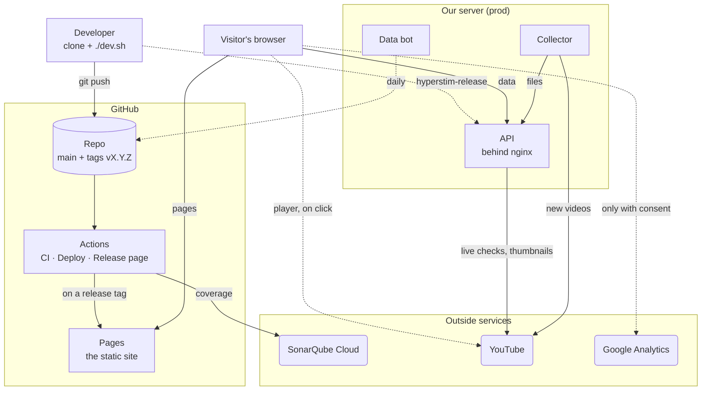
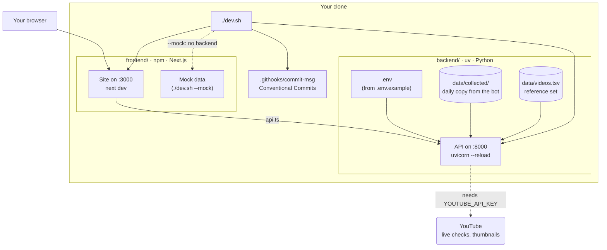
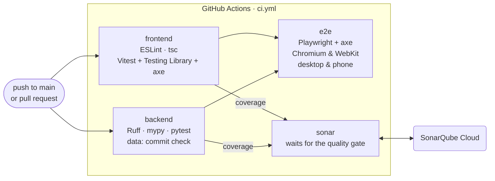
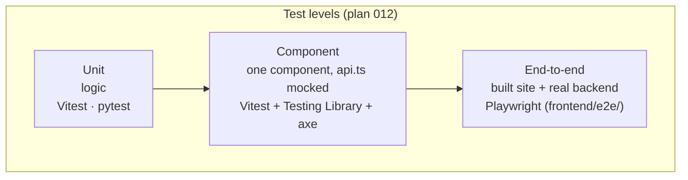
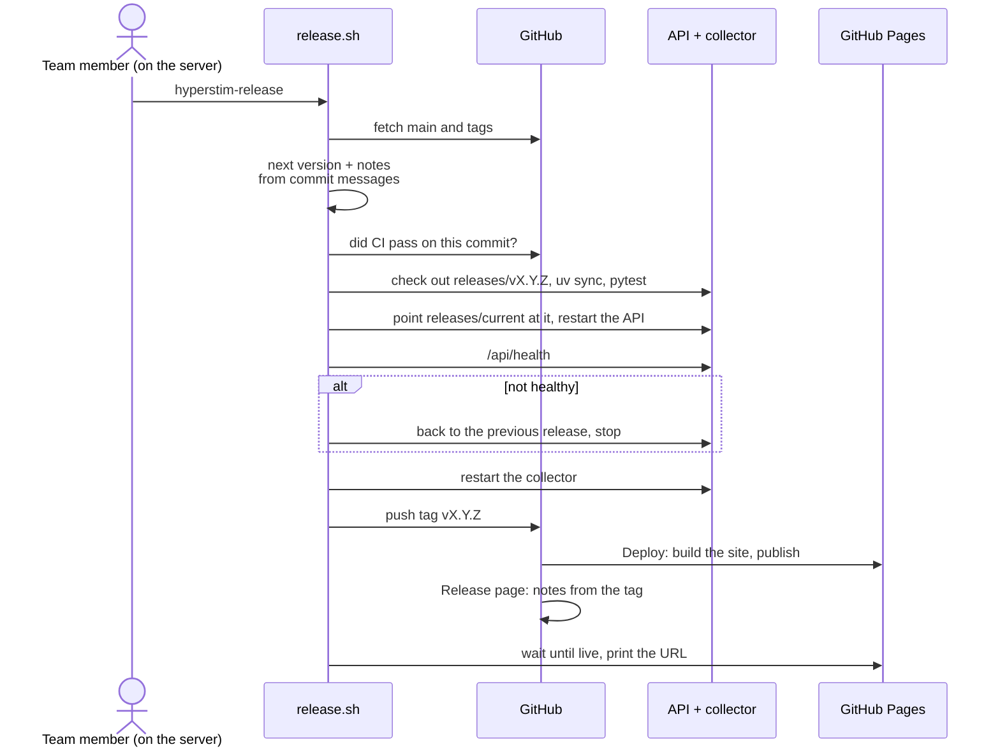
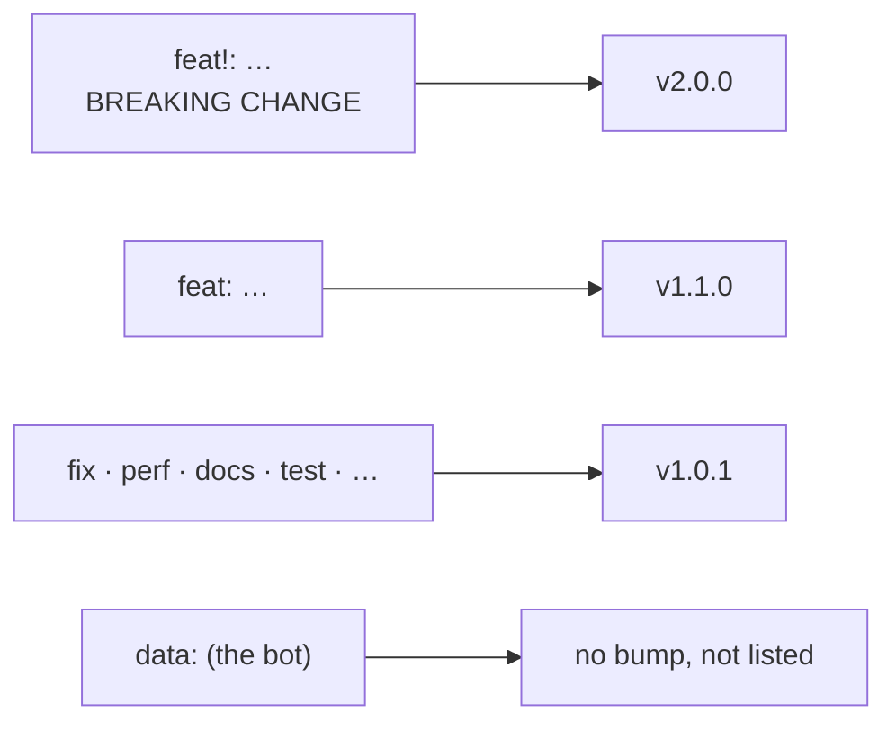
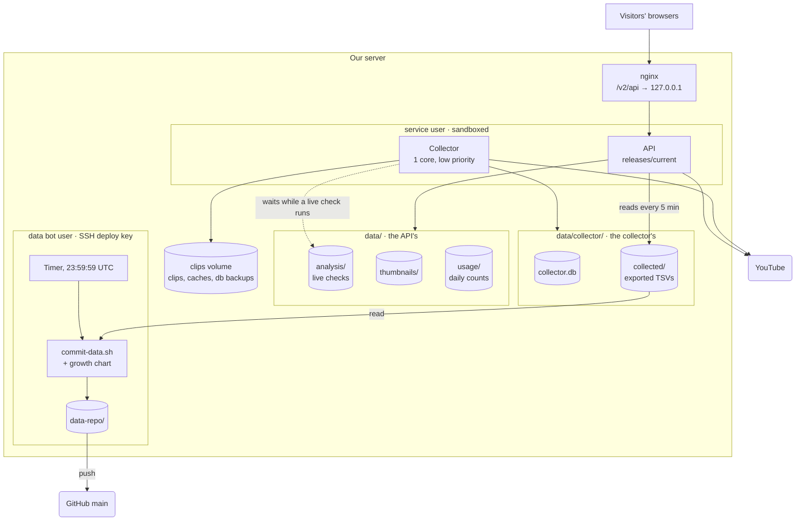
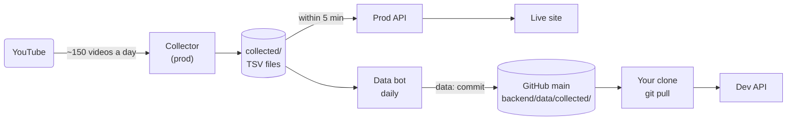
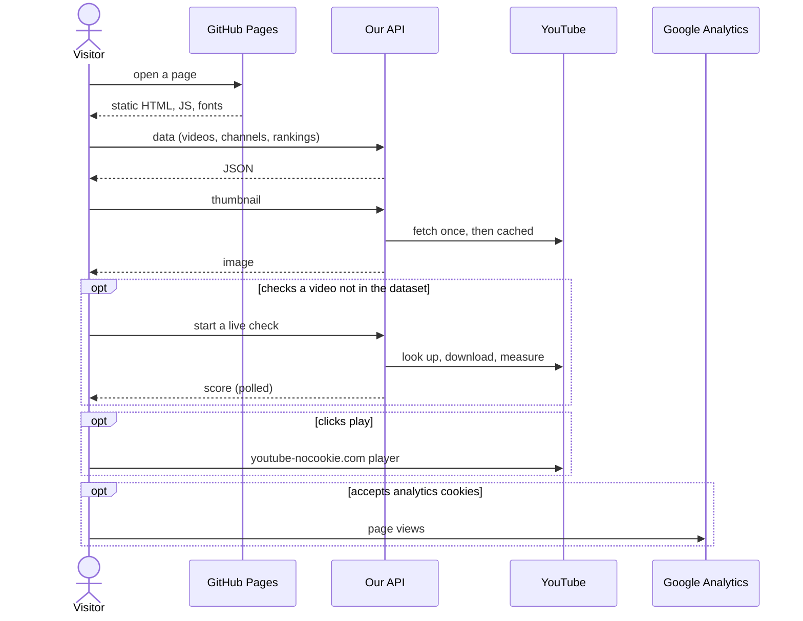

# Architecture

How the pieces fit together: dev, CI, prod, and the services outside. The details live in the plans (`plans/001-architecture.md` and the plan named on each diagram) and the READMEs; these diagrams are the map. Start with [`DEVELOPMENT.md`](DEVELOPMENT.md) to set up.

The diagrams are [Mermaid](https://mermaid.js.org/): GitHub renders them; in VS Code, install the "Markdown Preview Mermaid Support" extension (`bierner.markdown-mermaid`) and open the Markdown preview.

**Legend:** cylinders hold data, rounded boxes are outside services (GitHub's parts are grouped in a box of their own), dotted lines happen only sometimes (on a visitor's click, once a day, on a release).

## 1. The big picture

- The **site** is static files on GitHub Pages; everything dynamic goes through our **API**.
- The **collector** grows the dataset on the server; the **data bot** copies it to the repo once a day, so every clone gets it with `git pull` (plan 013).
- Nothing reaches prod without a **release** (section 4).

## 2. The dev environment

- One command starts both apps: `./dev.sh` (`--install-tools` once for Node, uv, ffmpeg, deno and the test browsers; versions in `tools.env`).
- The frontend talks to the backend only through `frontend/src/lib/api.ts`.
- No collector runs locally: dev reads the committed `data/collected/` (plan 013).

## 3. Tests and CI

What runs where. Locally you run the same commands (each README lists them); CI runs them on every push to `main` and on pull requests.

- Tests find elements by role and name, and every component and page gets an axe accessibility check.
- `release.sh` releases a commit only when all four jobs passed, including the end-to-end tests and the quality gate.

## 4. A release

`hyperstim-release`, run by a team member on the server (plan 010). Claude never starts one.

The highest type since the last release wins; the notes list every commit by section.

## 5. The prod server

What runs on our server (plan 010; layout in `deploy/README.md`). `deploy/setup.sh` sets it all up from `deploy/server.env`.

- The API and the collector run as one service user that can write only to `data/` (and the clips volume, for the collector).
- Only the data bot holds a key that can push, and only admins can create release tags, so the key can't start a deployment.
- The release group can read `analysis/`, `usage/` and `collector/` (plan 014); nobody else can.

## 6. How the dataset grows

Plan 013. One collector, on prod; everyone else gets its output from the repo.

- New videos are on the live site within minutes, with no release.
- Dev is up to a day behind prod.

## 7. A visitor's request

What visitors' data goes where is in the privacy policy (`/privacy`, plan 009).
