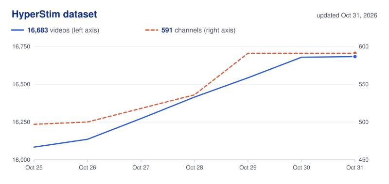

# HyperStim?

How stimulating are kids’ YouTube videos?

## What it is

[HyperStim?](https://aismithlab.com/hyperstim/) is a platform that helps parents understand how stimulating children's videos are by analyzing audiovisual features such as rapid scene changes, bright colors, and loud sounds. Parents can explore and compare videos to make more informed decisions about what their children watch.

## What you can do

- **[Check a video](https://aismithlab.com/hyperstim/):** paste a YouTube link and get its score.
- **[Rankings](https://aismithlab.com/hyperstim/rankings/):** the most and least stimulating videos and channels.
- **[Compare](https://aismithlab.com/hyperstim/compare/):** put two videos or two channels side by side.
- **[How it works](https://aismithlab.com/hyperstim/how-it-works/):** what we measure and what the score means.

## A growing dataset

We keep adding videos and channels. The chart is redrawn every day from the dataset's [changelog](backend/data/collected/CHANGELOG.tsv).

<picture>
  <source media="(prefers-color-scheme: dark)" srcset="backend/data/collected/growth-dark.svg">
  
</picture>

## What the score is and isn’t

We measure production style only, from a 5-minute clip of the video. We don’t judge a video’s content, educational value, or age appropriateness.

## How it’s built

A static Next.js site on GitHub Pages, and a Python (FastAPI) API that serves the video dataset and analyzes new videos. To run it or work on it, see [`DEVELOPMENT.md`](DEVELOPMENT.md).

## Privacy

What the site stores and who it shares data with: [privacy policy](https://aismithlab.com/hyperstim/privacy/).

## License

[Apache 2.0](LICENSE).
