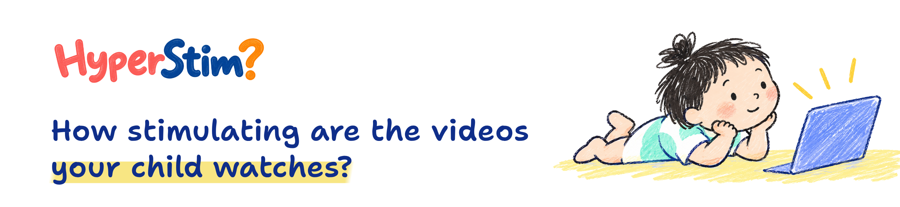
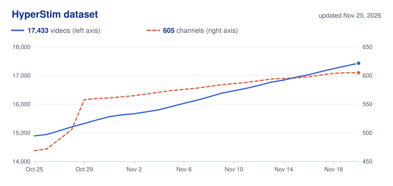

  

  <a href="https://aismithlab.com/hyperstim/"><b>Website</b></a> &nbsp;|&nbsp;
  <a href="https://aismithlab.com/hyperstim/how-it-works/">How it works</a> &nbsp;|&nbsp;
  <a href="https://aismithlab.com/hyperstim/rankings/">Rankings</a> &nbsp;|&nbsp;
  <a href="https://aismithlab.com/hyperstim/compare/">Compare</a>

  
  
  

## About

HyperStim? helps parents see how stimulating children's YouTube videos are. It measures a video's production style (how fast the scenes change, how bright and colorful the picture is, how loud the sound is) and turns it into a score you can compare across videos and channels.

## Features

- **Check a video:** paste a YouTube link and get its score.
- **Rankings:** the most and least stimulating videos and channels.
- **Compare:** two videos or two channels side by side.

## A growing dataset

We add videos and channels every day. The chart is redrawn daily from the dataset's [changelog](backend/data/collected/CHANGELOG.tsv).

<picture>
  <source media="(prefers-color-scheme: dark)" srcset="backend/data/collected/growth-dark.svg">
  
</picture>

## Development

A static Next.js site on GitHub Pages and a Python (FastAPI) API that serves the dataset and analyzes new videos. See [`DEVELOPMENT.md`](DEVELOPMENT.md) to run it locally or contribute.

## License

[Apache 2.0](LICENSE)
